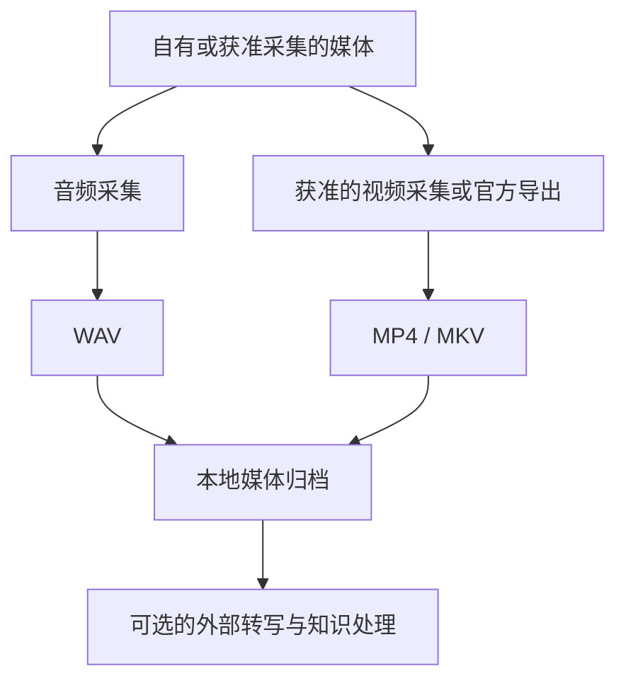

# Mobile Media Capture

> 手机音视频采集与本地媒体处理方案

**版本：V1.1（设计阶段）｜2026-11-27**

## 目的

将自有或明确获准录制、保存和转写的手机端媒体传输至电脑，形成标准 WAV / MP4 文件，便于个人学习、课程转写及知识管理。背景是部分课程只能在授权手机播放器中观看，未提供可直接处理的媒体文件。本项目独立维护采集硬件、软件配置、兼容性与验收，不与其他仓库混合，也不依赖任何其他项目运行。

播放授权不等于录制、复制或传播授权。若平台明确限制录制或外部输出，应选择官方授权导出、客户端、讲义或申请许可；不破解 DRM、HDCP 或播放器，不上传课程原件、授权码及个人数据。

## 设计

- 音频优先：针对允许采集的正常音频，使用 USB DAC、立体声线材、USB 音频接口与 Audacity。
- 视频可选：优先官方输出；对于允许采集的正常视频，可考虑兼容的 HDMI / UVC 采集设备与 OBS。
- 采集完成后输出标准媒体文件；下游 ASR 或知识处理由使用者自行选择，不在本仓库实现。
- 当前不包含已实现的软件自动化；硬件兼容性与端到端测试尚未完成。

## 文档

- [音频采集方案](docs/audio-capture.md)
- [视频传输与采集方案](docs/video-capture.md)
- [硬件清单](docs/hardware-list.md)
- [兼容性与保护机制](docs/compatibility.md)
- [实施计划及验收标准](docs/implementation-plan.md)
- [音频测试记录模板](tests/audio/README.md)
- [视频测试记录模板](tests/video/README.md)
- [自动化规划](scripts/README.md)

## 实施优先级

1. P0：确认授权、设备型号、正常输出能力及已有硬件。
2. P0：验证普通音频采集及完整课时的稳定性。
3. P1：确认正常视频输出、采集授权和设备兼容性，再考虑购置硬件。
4. P2：在采集稳定后评估自动归档等功能。

## 当前状态

设计文档，非已交付硬件系统。手机具体型号、播放器策略、已购设备、录制权限及实机测试结果均待确认。若保护机制阻止采集，不将绕过保护列为解决方案或验收要求。
